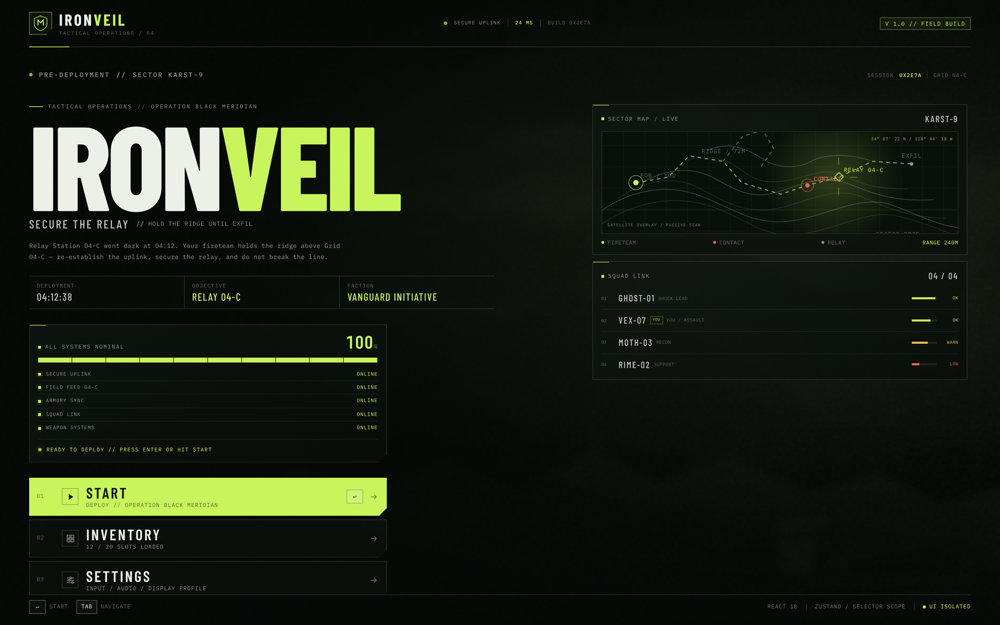
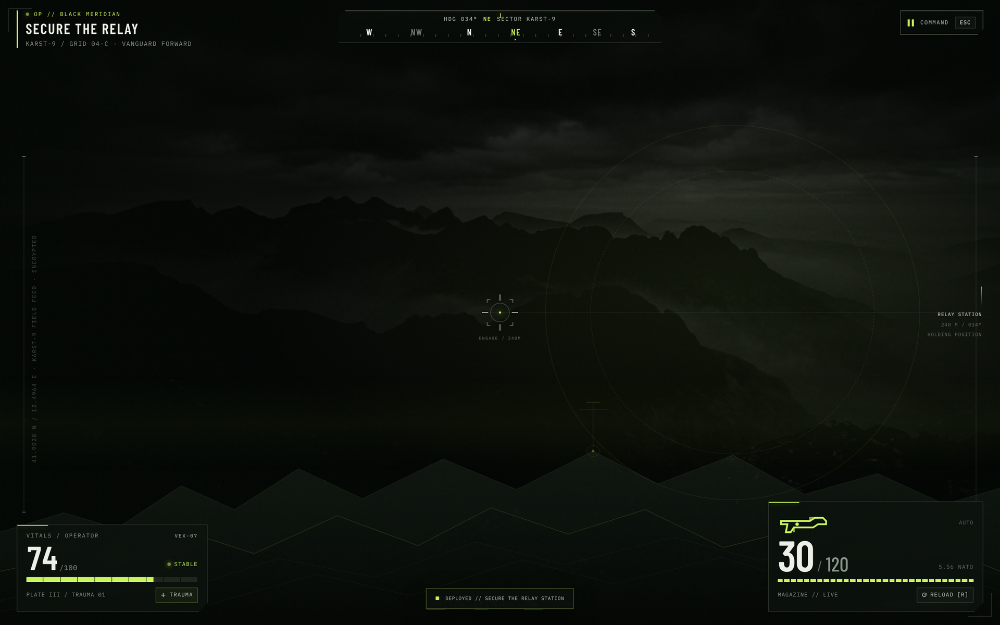
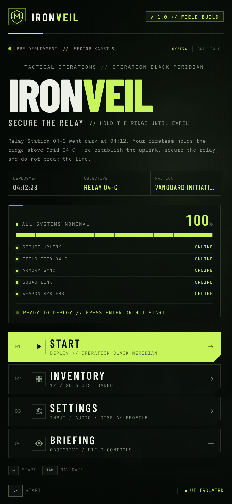

# Social--clone
This is a SoCal clone that is same as Reddit and Instagram but more lightweight and budget.

## IRONVEIL — Tactical Operations (game)

A single-file tactical game UI (React 18 + Zustand via CDN) lives in
[`game/index.html`](game/index.html) — open it directly or serve the repo and
visit `/game/`.

It boots to a **Start / Title screen**: a systems loading sequence (uplink,
field feed, armory, squad link, weapons) unlocks the **▶ START** button, with
INVENTORY, SETTINGS and a mission BRIEFING (controls) available before you
deploy. In-game, `ESC` opens the command/pause menu, which can also
**EXIT TO TITLE**. Back-navigation from the armory/settings returns to the
title screen before deployment and to the pause menu once in the field.

### Screenshots

**Start menu (desktop)** — loading complete, ready to deploy:

**Gameplay HUD** — after pressing START:

**Start menu (mobile):**

