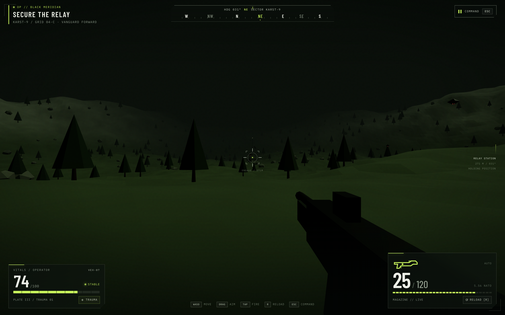

# Social--clone
This is a SoCal clone that is same as Reddit and Instagram but more lightweight and budget.

## IRONVEIL — Tactical Operations (game)

A tactical FPS (React 18 + Zustand + Three.js, built with **Vite**) lives in
[`game/`](game/) — run `cd game && npm install && npm run dev`, then open
<http://localhost:8000>. The start world is a real-time 3D first-person
terrain (procedurally generated Karst-9 ridges, the relay-station objective,
hostile hover drones) — **WASD + drag-aim** on desktop, floating **MOVE /
AIM thumbsticks + FIRE button** on touch devices.

It boots straight to a **Start / Title screen** and **▶ START is playable
instantly** — the systems check (uplink, field feed, armory, squad link,
weapons) is a ~0.4s cosmetic flourish that never blocks input. INVENTORY,
SETTINGS and a mission BRIEFING (controls) are available before you deploy.
In-game, `ESC` (or the COMMAND button) opens the pause menu, which can also
**EXIT TO TITLE**. Back-navigation from the armory/settings returns to the
title screen before deployment and to the pause menu once in the field.

**Developing:** edit [`game/src/ironveil.jsx`](game/src/ironveil.jsx) (UI) and
[`game/src/world.js`](game/src/world.js) (3D world) — Vite serves with HMR on
port 8000. `npm run build` produces `game/dist/`.

### Screenshots

Captured from the running game in headless Chromium. The terrain is rendered
live by WebGL (no backdrop photo anymore); only Google Fonts was stubbed
locally during capture because the sandbox can't reach it. Desktop shots show
the deployed first-person view mid-transition from the menu camera.

**Start menu (desktop):**

**Gameplay HUD — after pressing START:**

**Fired 8 rounds and reloaded (reserve 120 → 112):**

**Start menu (mobile):**

**Pause menu (mobile):**

