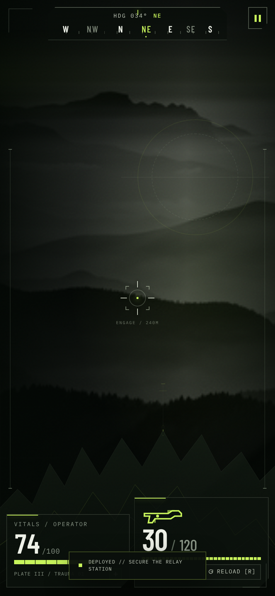

# Social--clone
This is a SoCal clone that is same as Reddit and Instagram but more lightweight and budget.

## IRONVEIL — Tactical Operations (game)

A single-file tactical game UI (React 18 + Zustand, pre-bundled — no runtime
CDN scripts, so it boots fast on mobile and even works offline apart from
fonts/photo) lives in [`game/index.html`](game/index.html) — open it directly
or serve the repo and visit `/game/`.

It boots straight to a **Start / Title screen** and **▶ START is playable
instantly** — the systems check (uplink, field feed, armory, squad link,
weapons) is a ~0.4s cosmetic flourish that never blocks input. INVENTORY,
SETTINGS and a mission BRIEFING (controls) are available before you deploy.
In-game, `ESC` (or the COMMAND button) opens the pause menu, which can also
**EXIT TO TITLE**. Back-navigation from the armory/settings returns to the
title screen before deployment and to the pause menu once in the field.

**Building:** `game/index.html` is a generated file. Edit
[`game/src/ironveil.jsx`](game/src/ironveil.jsx) /
[`game/template.html`](game/template.html), then run
`cd game && npm install && npm run build`.

### Screenshots

Captured from the shipped `game/index.html` in headless Chromium (desktop +
emulated iPhone). The sandbox used for capture can't reach Google Fonts or
Pexels, so only those two static assets were stubbed locally — real
Fontsource font files and a real black-and-white ridge photograph. All game
code and UI are the untouched production file; on your device the original
Pexels backdrop loads.

**Start menu (desktop):**

**Gameplay HUD — after pressing START:**

**Fired 8 rounds and reloaded (reserve 120 → 112):**

**Start menu (mobile):**

**Gameplay (mobile):**

**Pause menu (mobile):**

