## IRONVEIL — Tactical Operations (game)

**Status:** in active development — **not publicly published yet**. The
earlier Vercel project was paused at the owner's direction and stays paused
until the game is explicitly declared ready. Run it locally (below).

A tactical FPS (React 18 + Zustand + Three.js, built with **Vite**) lives in
[`game/`](game/) — run `cd game && npm install && npm run dev`, then open
<http://localhost:8000>. The start world is a real-time 3D first-person
terrain (procedurally generated Karst-9 ridges, the relay-station objective,
hostile hover drones) — **WASD + drag-aim** on desktop and strictly
side-isolated touch controls (**left half = MOVE only, right half =
direct drag AIM only**, plus FIRE / JUMP / RLD (reload) / CRCH (crouch
toggle) thumb buttons) on touch devices
(`SPACE` jumps on desktop). A realistic day/night cycle (one 15-minute macro day: 10-minute daylight,
5-minute night; sun, moon, stars, spiral galaxies — `T` skips +3h, `?phase=0.75`
starts at midnight) plays over a river-carved valley with a plank bridge,
and everything is sonified with WebAudio SFX: a recorded rifle shot
(synth fallback), UI clicks, grass/water footsteps, landing thuds,
river, birdsong, crickets, wind (`M` mutes).

Two map presets are selectable on the start screen (or via `?map=br` /
`?map=survival`): **Battle Royale — 2×2 km** (4 chunks) and **Survival —
4×4 km** (16 chunks). Terrain streams in 1 km chunks around a center spawn
at `(0, heightAt(0,0), 0)`; the relay and river are seeded per session
(`?seed=` reproduces a layout). The river is a real crossing obstacle: a
gentle **58 m valley cross-section** with a monotonic north-to-south bed
profile and **0.9 m waist-deep wading** (deep spots and the southern sea
shallows buoy the camera with a swim float), spanned by a plank bridge. Combat rendering keeps grass,
pebbles and rocks inside **35 m**; five Myanmar tree archetypes (teak,
padauk, rain tree, banyan and toddy/coconut palm) use one unified
whole-tree mesh per LOD band — full detail to 45 m, low-poly to 95 m and a
merged trunk+canopy imposter from 95–150 m — so trunks and canopies can
never cull separately or leave floating leaves. Climate-driven exponential
fog still allows clear ~300 m sightlines in Sunny weather. Procedural rim mountains
ring both maps: Survival hard-clamps at ±1950 m, while pressing the BR
±1000 m line triggers **RETURN TO THE COMBAT ZONE** at −5 vitals/sec.

Terrain LOD + streaming: the chunk you stand in builds at **64×64**
segments, ring 1 at 48, ring 2 at 28 and ring 3+ at 14. Terrain uses
simple Rust-baked vertex colors/AO with no splat attribute or custom
roughness shader. Chunk builds
run as time-sliced jobs (~3.5 ms of work per frame, prioritised by distance
and view direction, with predictive prefetch), so crossing into a new chunk
no longer hitches. Shooting raycasts run on a BVH
([three-mesh-bvh](https://github.com/gkjohnson/three-mesh-bvh), MIT).
Movement is a PUBG-Mobile-style kinematic character controller without a
rigid-body physics engine. The same deterministic step runs in Rust on the
main thread (with a field-for-field JS twin as fallback): Quake-style
projection-capped acceleration and control-speed ground friction, capped
air control, projected slope gravity, steep-slope blocking/sliding with
contour slide, 0.55 m step-up and downhill snap, coyote-timed jumping, and
hard-landing momentum damping. Analog walk/jog now tops out at a natural
**5.2 m/s**; holding the stick (or W) near-straight forward for **1 second**
latches a stamina-limited **7.6 m/s sprint**, while `C`/`Ctrl` crouch scales
speed to 50% and lowers eye height from 1.70 m to 1.25 m. An
anti-underground safety sweep checks the player every frame and live
drones at 4 Hz against the Rust-backed ground authority; a confirmed bad
position is rescued to nearby dry, walkable ground and recorded in the
ABI v5 Rust safety-report ring. Stride-based camera bob, landing dip, the
damped-spring rifle viewmodel (sway + synced bob) and a physical magazine
drop/re-seat reload animation remain. Grounding comes from instanced blob
shadows under the player, trees and the relay, deterministic instanced
grass tufts and small pebbles inside 35 m, and a merged low-poly tactical
rifle viewmodel. The clean HUD is three thin bottom-left stripes
(red HP, blue stamina, green armour) plus two centered PUBG-style weapon
slots; an unused second slot stays visibly empty.

Weather & seasons are gameplay systems. Ten macro days form a season
(Dry → Cool → Monsoon); terrain/foliage palettes, exponential-fog density
and color, sunlight/ambient/exposure, and AI line-of-sight lerp over 30 s.
Every 10 real minutes a weighted roll chooses Sunny, Mist or Monsoon
(Dry 60/30/10, Cool 50/40/10, Monsoon-season 10/40/50 for Sunny/Mist/Rain).
Sunny uses density 0.0024 and 300 m drone LOS with a shader sun halo; Mist
uses 0.034 and 50 m LOS; Monsoon uses 0.0215, 80 m LOS, a screen-space
rain/visor shader, and mud physics (−30% acceleration, longer decel slide).
`?season=dry|cool|monsoon`, `?weather=sunny|mist|monsoon`, and `?day=N`
set the starting climate; the debug overlay (backtick / F3) shows season,
weather blend, fog density, AI LOS and engaged drones.

**Credits:** the recorded gunshot (`game/public/sfx/gunshot.wav`) is from
the Godot engine's TPS demo (© 2018 Juan Linietsky, Godot contributors),
distributed under CC-BY 3.0 — trimmed/mono-mixed here, with per-shot pitch
jitter and a synthesized sub-thump layered in `game/src/audio.js`.

It boots straight to a **Start / Title screen** and **▶ START is playable
instantly** — the systems check (uplink, field feed, armory, squad link,
weapons) is a ~0.4s cosmetic flourish that never blocks input. Short
landscape screens compact the title stack so START stays visible without
scrolling; deploying hands keyboard focus to the game canvas, and WASD is
listened for in the capture phase with an `e.key` fallback, so movement keys
work even after clicking START inside an embedded preview. INVENTORY,
SETTINGS and a mission BRIEFING (controls) are available before you deploy.
In-game, `ESC` (or the COMMAND button) opens the pause menu, which can also
**EXIT TO TITLE**. Back-navigation from the armory/settings returns to the
title screen before deployment and to the pause menu once in the field.

Terrain generation runs on a **Rust → WebAssembly ABI v5 core**
(`game/wasm/ironveil-core/`, dependency-free). A dedicated module Web
Worker (`game/src/wasm/terrain-worker.js`) owns a second Rust instance and
returns transferable typed arrays for **(1)** streamed full chunk meshes
(positions, normals, vertex colors, baked light, indices — no splat),
**(2)** deterministic local grass/pebble scatter batches, and **(3)** drone
LOS/threat/tactical waypoints plus coarse A* paths. The main thread keeps
the Rust per-frame kinematic physics step (zero worker round-trip latency),
the ABI v5 fixed-size safety-report sink, the 3-weather × 128-bin sky/cloud
LUT and rendering. Terrain colors include
Rust-baked AO (eight-direction horizon slope + concavity, faded to 1.0 at
chunk borders to avoid seams). Streamed work uses the Worker; teleport
destination cuts still finish synchronously on the main thread so arrival
never shows a terrain hole, and if Worker or WASM fails the game
falls back fully to the main-thread Rust/JS paths. The 112,916-byte compiled
asset is committed at `game/public/wasm/ironveil_core.wasm` and loaded
locally — **fully offline at runtime, no CDN**. The production build uses a
relative Vite base, and the loader validates the WASM magic across root,
subpath and Worker-relative candidates, so the same build runs from a
domain root or a repository subpath. The debug overlay shows
`PHYSICS: RUST KINEMATIC`, `WORKER: RUST`, and live main-thread CPU ms when
active. Rebuild it with the *Build Rust WASM terrain core* GitHub Action
(or `cargo build --release --target wasm32-unknown-unknown` locally).

The frame loop was also put through a zero-allocation pass: preallocated
physics and profiler buffers, scratch river/chunk/palette objects, direct
final-height grids, lazy JS fallback geometry (Rust chunks no longer build
and discard a PlaneGeometry), and reused shooting targets. Frequent HUD
values no longer flow through React renders — compass heading, objective
distance/bearing, crosshair range/fire state, weapon-slot ammo and the
stamina stripe are updated through refs/direct DOM writes. Mobile fill
rate is protected by the live render-quality setting — **MED is the default**
(coarse pointers start at 1.1× DPR, cap at 1.25×, shed resolution above a
15.5 ms average frame and only buy it back under 11 ms, targeting smooth
~70 fps play; LOW pins 1.0×). MSAA and the full-screen CSS noise blend are
disabled on coarse pointers, keeping a cheap flow-sine water shader with
horizon tint and sun glint, and the existing fragment-space sun disc/glow.

**1-minute traversal CPU profile** (final ABI v5 build, headless
Chromium/SwiftShader, seed 20261029, Survival, 374 profiled frames;
sandbox FPS is not phone-representative, so these are main-thread CPU
ms/frame from `?profile=1`):

| CPU metric | avg | p50 | p95 | p99 | p99.9 |
| --- | ---: | ---: | ---: | ---: | ---: |
| Update | 1.074 ms | 0.3 ms | 2.6 ms | **16.8 ms** | 41.6 ms |
| Render submission | 10.750 ms | 0.6 ms | 1.1 ms | **11.4 ms** | 1396.1 ms |
| Total | 11.824 ms | 0.9 ms | 4.7 ms | **43.2 ms** | 1397.3 ms |

The route crossed ten streamed neighbourhoods and finished with Rust
terrain/physics/Worker active, 16/16 chunks, 62 Worker chunks, 136 Worker
scatter batches and 68 Worker AI batches. Maximum observed load was
**42,373 triangles / 49 draw calls** (final frame 23,716 / 33), safely under
the 60k triangle budget. Tree bands peaked at 11 full / 38 low-poly / 53
imposters; because each band is one merged trunk+canopy geometry, no tree
can degrade into floating leaves. The single p99.9 render outlier is a
SwiftShader/teleport upload frame in the software-rendered sandbox; the
reported production metric for this pass is total CPU **p99 = 43.2 ms**.

**Developing:** edit [`game/src/ironveil.jsx`](game/src/ironveil.jsx) (UI) and
[`game/src/world.js`](game/src/world.js) (3D world) — Vite serves with HMR on
port 8000. `npm run build` produces `game/dist/`.

### Screenshots

Captured from the running game in headless Chromium. The terrain is rendered
live by WebGL (no backdrop photo anymore); only Google Fonts was stubbed
locally during capture because the sandbox can't reach it. Desktop shots:
the Survival center spawn, Monsoon weather at 190 m east (AI LOS 80 m,
0/6 drones engaged), the BR rim wall at +850 m, its out-of-bounds warning
at the +1000 m line, and midnight under the stars and galaxies.

**Start menu (desktop):**

**Survival (4×4 km) — center spawn at (0, 0):**

**Rust ABI v2 — baked terrain AO and refined rifle viewmodel:**

**Rust ABI v3 — mesh/scatter/AI batches and sky LUT active (`RUST V3` debug row):**

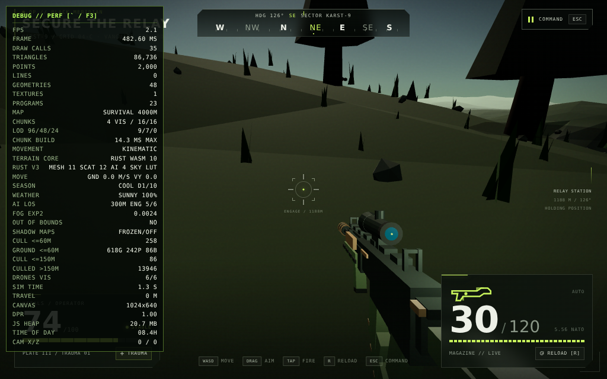

**Rust ABI v4 + Worker — Rust kinematic physics and worker terrain/AI active (`PHYSICS` / `WORKER` debug rows):**

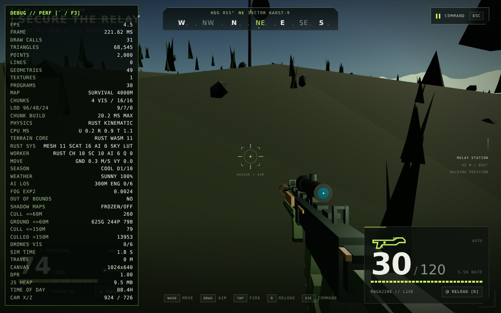

**Mobile performance / Myanmar tree LOD / clean HUD — whole-tree LODs, three vitals stripes and two centered weapon slots:**

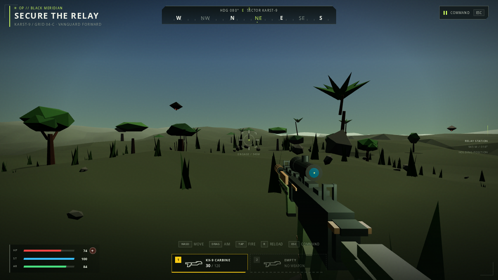

**Monsoon weather — screen-space rain, 80 m AI LOS, no drones engaged:**

**Battle Royale — rim mountains rising from +850 m:**

**Battle Royale — out-of-bounds warning at the +1000 m line:**

**Midnight — stars, a spiral galaxy and moonlit ridges:**

**Start menu (mobile):**

**Pause menu (mobile):**

## Corrective round — terrain, collision, trees, F3, mobile-first HUD

After field reports of walking into hills / seeing inside terrain, detached
tree segments, square terrain, a mountain-everywhere map and a PC-first HUD,
this round reworked the foundations (verified by actually walking the river,
a steep hillside and the southern coast in a real browser, JS fallback and
Rust/WASM paths alike):

- **Myanmar-balanced terrain.** Quintic, domain-rotated FBM noise feeds a
  biome-masked height model: southern Ayeyarwady-style delta easing through a
  beach into a shallow sea (`SEA_LEVEL 0.25`), central Dry-Zone lowland, hill
  belts only to the north/west and a lower eastern plateau. Map-wide sample:
  ~3% sea, ~20% delta, ~22% lowland, ~36% hills, ~18% high rim/belts. Smooth
  shading, 96-segment near chunks (LOD 96/64/32/16) and a vibrant biome
  palette plus world-space detail in the existing material — no extra draw
  calls. Analytic-vs-rendered-mesh height error dropped from **0.569 m
  average (15,252 of 123,201 samples > 1 m)** to **0.026 m average (16 > 1 m)**.
- **Surface-true collision.** Physics (JS and Rust ABI v5 share the host
  ground provider) now steps on the *rendered triangle surface*, dilated by
  capsule-shoulder samples, integrated at 120 Hz substeps so slopes are
  resolved instead of tunneled — the same discipline future fast vehicles
  need. Nearby tree trunks, boulders and the relay mast are solid via a
  preallocated local-obstacle resolver, and a final camera-clearance lift
  keeps the near plane out of hillsides. Scatter, drones and the safety
  sweep all read the same surface, and nothing scatters under the sea.
- **Connected trees.** All five species × three LODs are now built from
  limbs authored endpoint-to-endpoint with joint blobs at every fork and
  root flares buried below grade (banyan aerial roots reach the ground;
  palm trunks are jointed chains into a crown bulb). Species are chosen by
  biome — palms/banyans in the wet south, teak/padauk in hill forest,
  rain trees and toddy palms in the Dry Zone.
- **F3 debug/perf menu has a real switch.** One shared store flag drives the
  `F3` key, the HUD **F3 ON/OFF** chip, Settings → Interface → *F3 DEBUG /
  PERF OVERLAY*, and the overlay's own header button. It is **off by
  default** and its 4 Hz tick stops while hidden.
- **Mobile-first HUD and controls.** Larger floating sticks (128 px base /
  64 px throw), a 92 px FIRE button with dedicated 64 px **RLD** and
  **CRCH** buttons, compact coarse-pointer vitals/ammo, touch-first hints
  and bindings, and a phone-landscape title layout where START, INVENTORY
  and SETTINGS fit with zero scrolling (verified at 844×390: buttons
  visible, CRCH toggles crouch, stick drag moves the player, F3 chip works
  by touch). Browser walks on the rebuilt WASM show Rust terrain/physics/
  Worker active, grounded movement at the river (wading), uphill and along
  the coast with **0 safety rescues**.

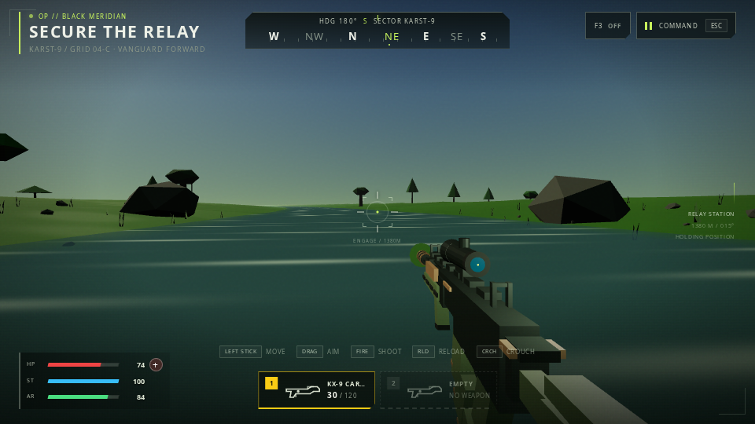

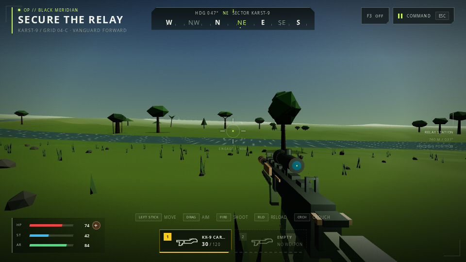

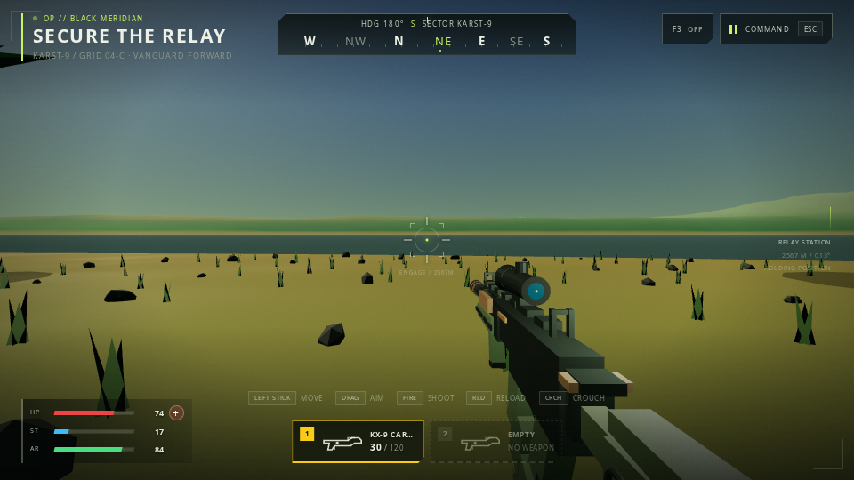

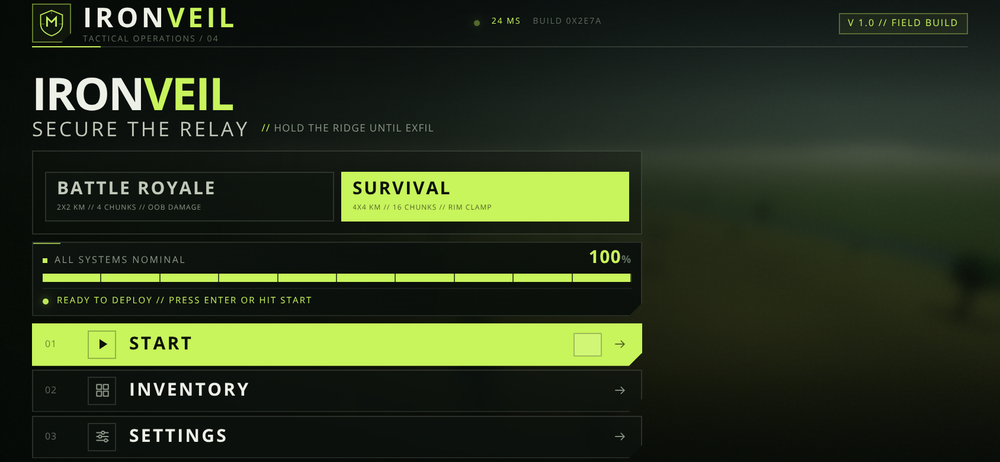

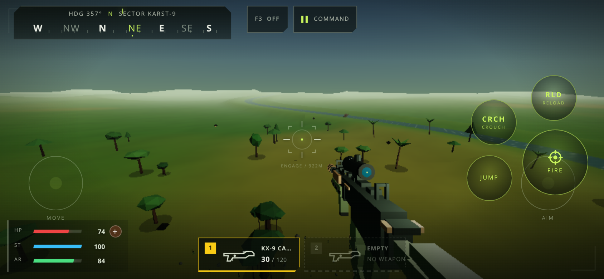

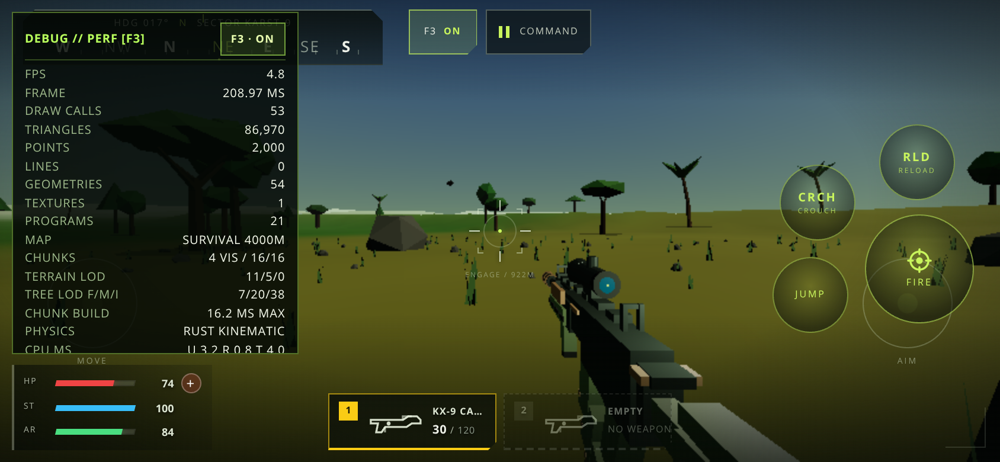

## Physics grounding, FOV feel and stamina round

- **Everything physical is grounded before its first frame.** Rocks and
  future vehicle-style bodies rest on the highest rendered ground inside
  their footprint (`groundSupportHeight` / `groundedBodyY`); trees seat
  their root disc on the lowest point so downhill roots touch; pebbles and
  grass roots are buried a few cm; drones spawn settled above their
  anchors. A shot-down drone tumbles once, then **rests on top of the
  terrain as a solid wreck** — the safety sweep re-seats it if anything
  ever pushes it under. Impact debris also lands and skids instead of
  falling through the world. Player collision now also covers banyan
  aerial roots, larger pebbles, the relay equipment hut/crates and drone
  wrecks, and the relay platform itself is a walkable deck in the physics
  ground provider. Browser check: walking straight at the relay mast stops
  at **0.9 m** with zero safety rescues; 21,556 placements report grounded.
- **Trees read as one grown organism.** Limbs are thicker and driven
  deeper into enlarged joint blobs at every fork, and every trunk now ends
  in a wide root-flare skirt that welds it into the soil.
- **FOV is real and alive.** Settings → Display → *FIELD OF VIEW* (55–100°,
  default 71°) drives the camera. On top of the base angle: a sprint
  stretch up to +7°, a subtle walk-cycle pulse, a small wading push and a
  landing punch-in — all smoothed. The gun mirrors it: sprinting cants the
  rifle across the body and pumps it with the stride; wading raises it
  clear of the surface.
- **Sprint fades with stamina.** Sprint is available whenever stamina
  remains, at full power down to ~55 stamina; below that, speed (7.6 →
  5.2 m/s), FOV kick and gun pose taper smoothly to a jog instead of
  cutting off. Verification series: stamina 100 → 34 saw effect 1.00 →
  0.70, speed 7.6 → 6.9 m/s, FOV 79.4° → 77.5°. Soda, stimulants and
  medicine share one boost channel (instant restore + timed regen +
  sprint-power floor); the trauma kit already feeds it, and drink/drug
  items can call `boostStamina(kind)` when they land.
- **Water you can feel.** Entering water fires a splash burst + sound;
  every submerged step kicks pooled droplets at the alternating foot and
  plays depth-graded slap/drag audio. Verified wading at 0.86 m depth.
- **No aim joystick.** The right half of the touchscreen is now a naked
  drag surface (no base, nub or hint) — the camera follows the thumb 1:1.
  Only the left MOVE stick remains. A dedicated round **RLD** button sits
  immediately left of the weapon slots (pulses red at low ammo); mobile
  verification fired 30 → 26 and reloaded to 30/116 through it.

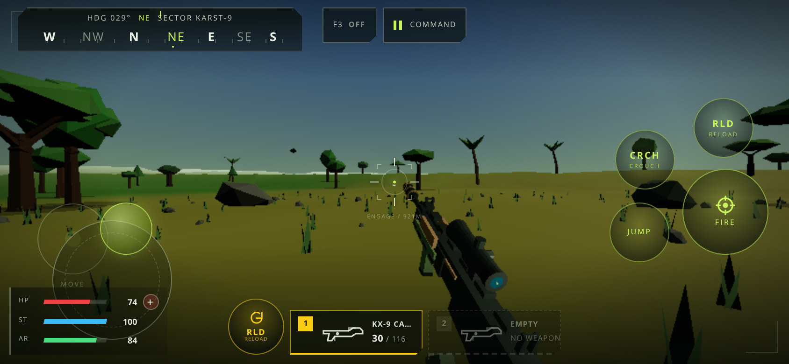

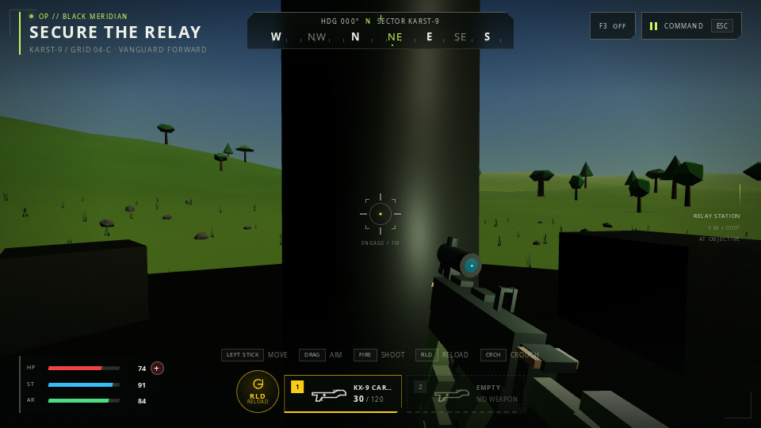

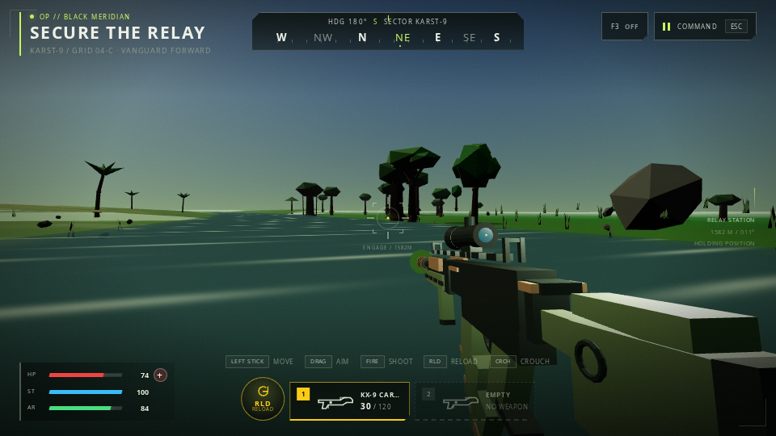

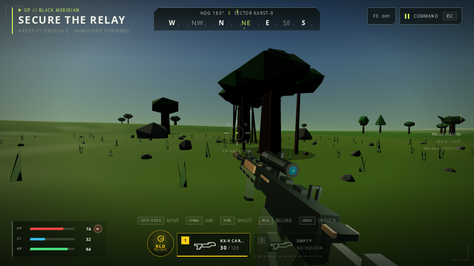

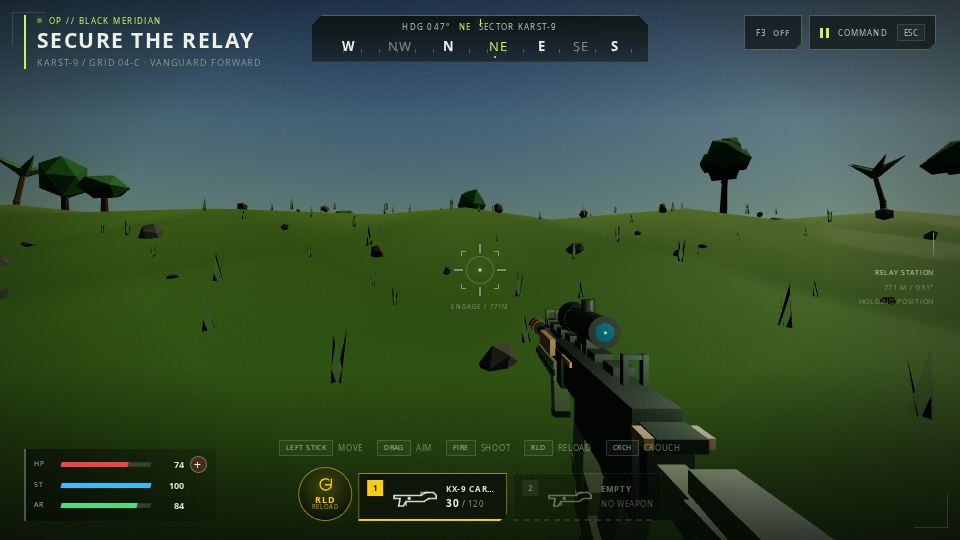

## Clean start, ADS/gun-swap and Warthog round

- Opening screen is now a three-button white/gray cloud-and-water card: **Single Player**, **Settings**, and a locked **Multiplayer** button with monochrome glitch feedback and “It isn't available yet, only beta.”
- The opening orbit cinematic plays only on the first deployment after opening the app. Settings/pause now freezes the exact player camera, and resume is instant—no cinematic replay.
- Resolution is locked to native `devicePixelRatio` through rotation/resizing. ADS/scope, ADS sensitivity, forward firing pose while sprinting, and PUBG-style tap-to-draw weapon slots with per-slot magazines are active.
- A Warthog is parked at **X 18 · Z 0**, facing north on a 460 m strip. Walk near it for **DRIVE**; use **EXIT** after landing and stopping. Flight uses SI thrust/lift/drag, angle of attack, stall, density, coordinated bank, rolling resistance, brakes and gear drag. Controls: left stick/WASD pitch+bank, THR +/− or Shift/Ctrl throttle, BRK/Space brakes.
- The HUD always shows live **COORD X · Z · Y** in metres, so new objects can be requested by exact coordinate.

Real gameplay captures:

- 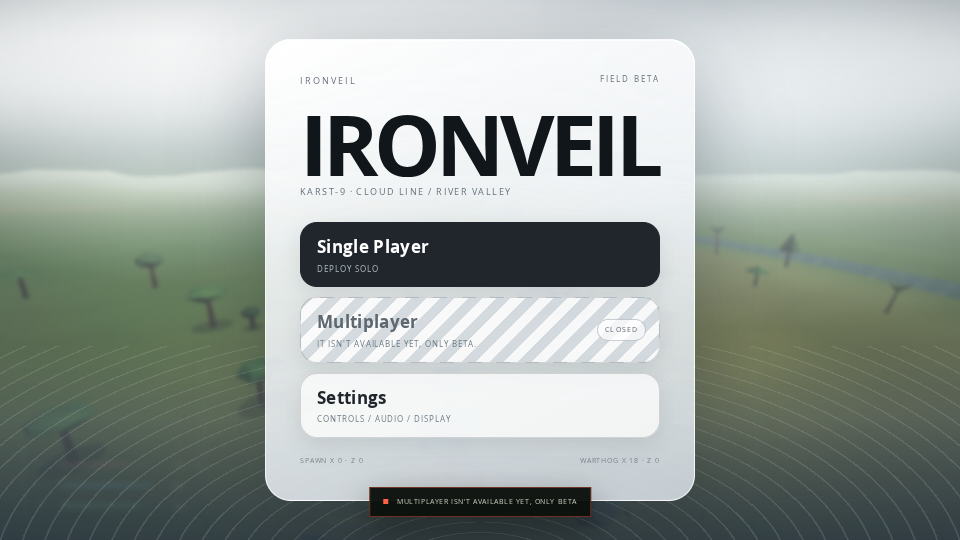
- 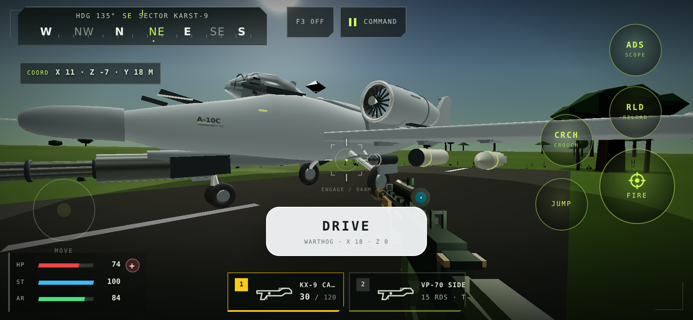
- 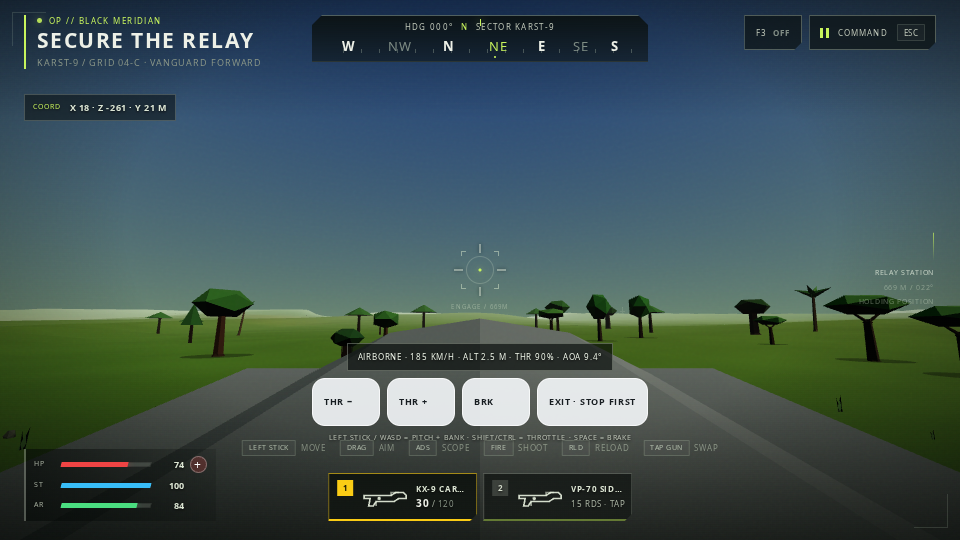
- 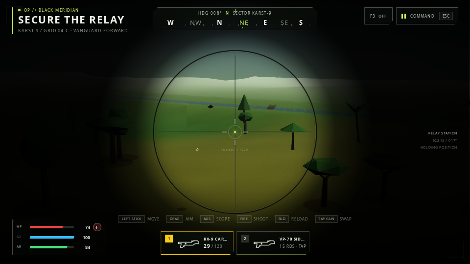
- 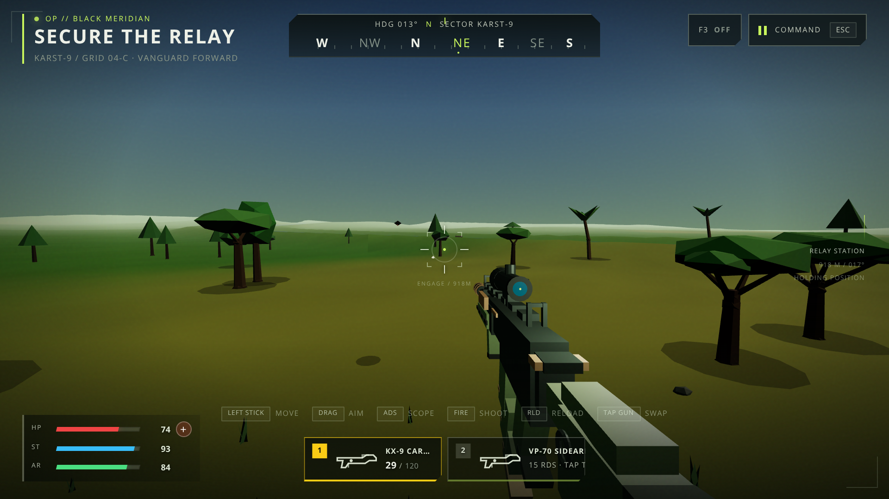
- 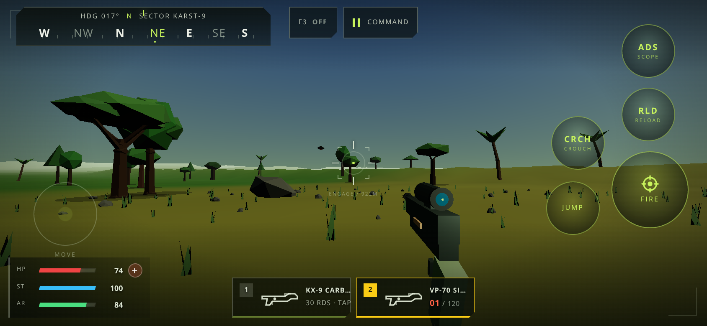
- 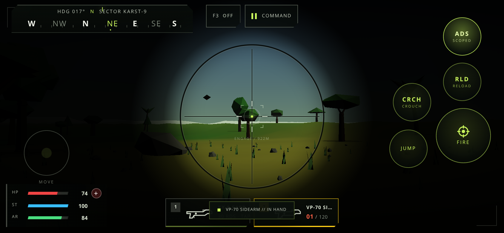

Browser verification included: exactly three opening buttons; Multiplayer glitch; settings→resume with `cinematicActive=0`; Warthog DRIVE at X 11/Z 0, stopped EXIT to X 23/Z 0, re-enter, 165 km/h roll by Z −195, airborne at 182 km/h/2.1 m AGL by Z −245, safety rescues 0. Vercel remains **paused/unpublished**.

## Supplied Warthog pack, animated canopy and aircraft HUD round

- The low-poly placeholder airframe from the previous build has been replaced with the supplied **A-10C Warthog pack** (`game/src/aircraft/warthog.ts`). The game uses its Ghost Grey livery and standard loadout; after the cockpit additions it reports **10 parts / 255 meshes / 21,046 triangles**. The pack's nose-+Z authoring is adapted to the game's forward--Z flight model, with a measured +2.36 m gear offset so the torus tyres sit on the strip, and its PBR materials receive the same RoomEnvironment-style reflections used by the supplied viewer.
- The canopy is now a rear-hinged moving assembly. **DRIVE** opens it before seating, it closes after the pilot is in, and a stopped **EXIT** opens it again before stepping out and latching behind the player. In first person only the glass is hidden; the bows, rails, glareshield, three MFDs, gauges, side consoles, pedestal, stick, throttle quadrant and HUD combiner remain visible.
- `AircraftInterface` is deliberately airframe-agnostic. It reads generic `aircraftName`, pitch, roll, heading, vertical speed and control-deflection telemetry, so future aircraft can reuse the same artificial horizon, speed/altitude/AOA/G/gear readouts and canopy state without a Warthog-specific HUD branch.
- Flight touch controls are mobile-first: a large **SWAY STICK** (push up to climb, down to descend, sideways to bank), an absolute **THR SLIDE**, plus THR − / THR + / BRK / EXIT. The world shapes the stick with a soft centre and exponential smoothing for easy small corrections while retaining full control at full throw. Its ground-steering authority fades out by 18 m/s, so a diagonal sway during the takeoff roll no longer drives the jet off the strip. WASD and Shift/Ctrl remain available on desktop.
- Real browser verification on the Vite build: canopy opening captured at 47%, seated/closed cockpit, stopped EXIT and re-entry, desktop throttle target 0.947, sway input P +0.79/R +0.38, airborne at **228 km/h, 0.9 m AGL, heading 001°** near X 20/Z −435, and mobile touch at 844×390 with throttle target 0.935 and sway P +0.76/R +0.40. Safety rescues: **0**. Vercel remains **paused/unpublished**.

Real gameplay captures from this round:

- 
- 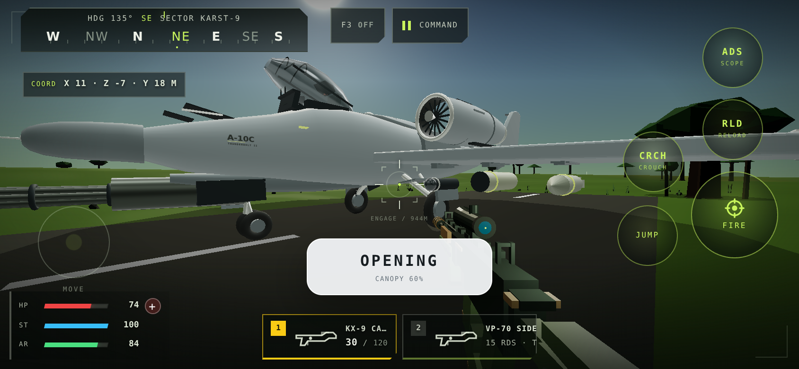
- 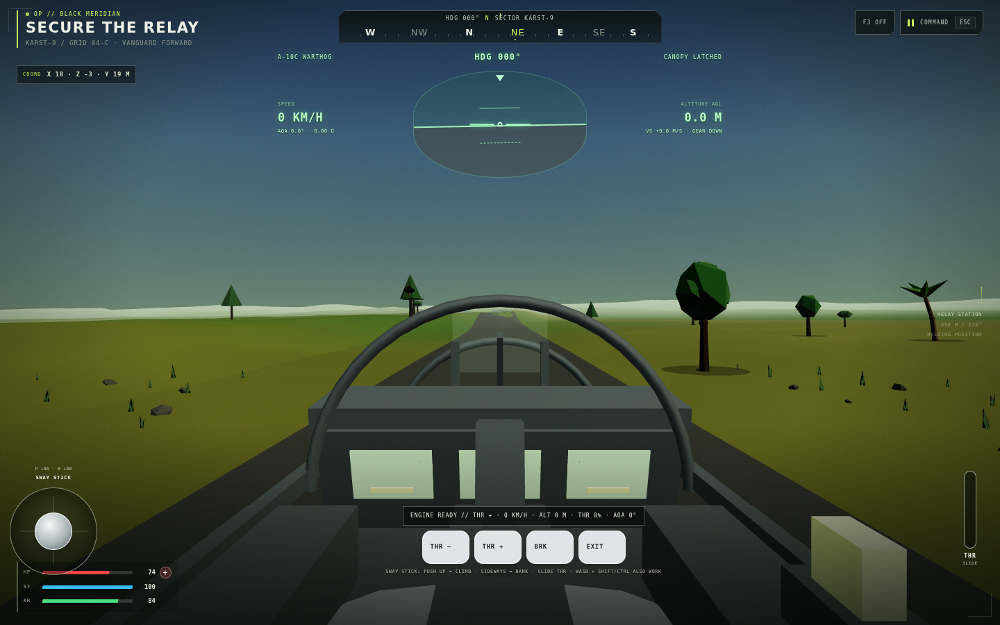
- 
- 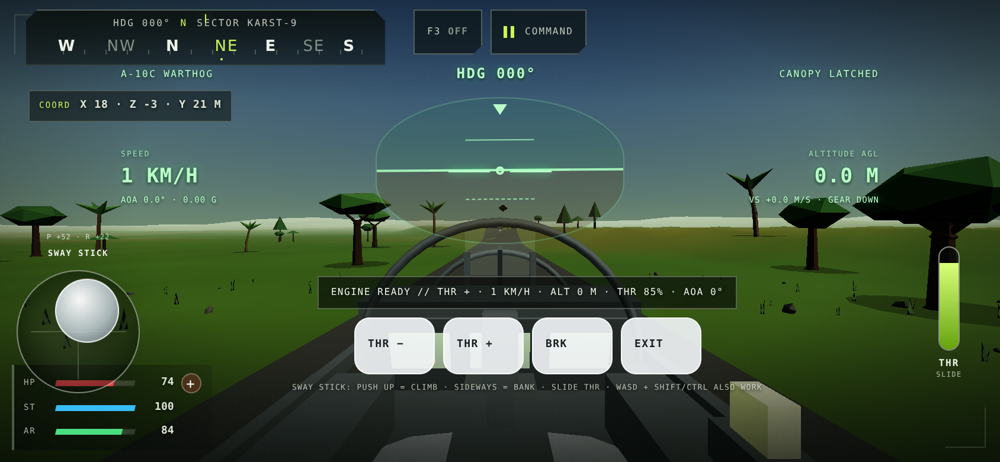

## Aircraft damage/weapons, anti-PS2 triangles and resource-management round

- **Flight controls were refined, not replaced.** The seated console keeps the
  user-selected W/S triangles on the left and A/D triangles on the right, with
  independent W/S and A/D reversal in Settings. They are clean clipped
  triangular military pads — **anti-PS2 style**, with no circular emulator
  face-button/glyph layer. Thrust is still manual: entering the canopy does not
  start or launch the jet. On the ground A/D car-steer, S brakes then gives a
  slow pushback/reverse, and W only rotates the aircraft once speed and pitch
  authority are sufficient. In the air W/S and A/D retain free continuous
  pitch/roll, BRK is the airbrake, and damage now feeds the same solver. A
  soft alpha limiter fades pitch authority near the stall (without locking
  out aerobatics), gentler pitch/roll rates make the jet easier to hold, and
  a developed stall pitches the nose down to recover the wing.
- **Reusable aircraft damage core.** `game/src/aircraft/aircraft-core.js` is
  Three.js-independent and owns ten component IDs (fuselage, cockpit, both
  wings, both engines, tail, forward gun, stores/launchers and gear), armor,
  health, derived lift/thrust/control/drag/asymmetry, fire logic, kinetic
  collision damage and tactical advisories. The supplied Warthog pack supplies
  matching part groups, fan spool, emissive damage visuals and reset; its
  reversed authored port/starboard signs were corrected so shooting, lamps,
  detachment and the diagram all refer to the same physical side.
- **Every major piece can be damaged and lost.** The on-foot rifle uses a
  12 m aircraft broadphase and then the cached runtime hit meshes, so shots
  damage the actual wing/engine/tail/gun/stores/gear they strike. Generic
  `worldControl.aircraftDamage` and `worldControl.explodeAt` events let
  explosives, missiles, launchers, artillery or future systems use the same
  door. Obstacle and terrain impacts scale from aircraft kinetic energy
  (`½mv²`), remove inward velocity, and can tear off the authored part group as
  falling debris. Retracted gear and detached parts are no longer collision
  samples, and the parked aircraft cannot collide with its own on-foot
  obstacle discs.
- **Fire, explosion, ejection and death are one chain.** Engine/fuselage fire
  starts a finite 14-second cook-off window with escalating advisories and
  burn damage. Exploding while seated kills the operator and opens the
  `OPERATOR DOWN` respawn overlay; ejecting first launches the pilot clear,
  deploys the parachute after 0.78 s, caps descent and returns control on
  landing. A stopped wreck no longer offers DRIVE, and DRIVE is also suppressed
  while descending under canopy.
- **Weapons exist only where the model installs them.** The reusable solver
  reads model configuration. This A-10 config installs the pack's GAU-8/A
  forward gun (1,174 rounds) and two AIM-9-class missiles; destroying `gun`
  or `stores` disables only that capability. Cannon shells (42) and missiles
  (8 objects) are pooled, and the projectile update is skipped entirely when
  both pools are idle.
- **Cameras and damage readouts.** The top-right aircraft button toggles
  COCKPIT and third-person CHASE (the old pointerdown+click double-toggle was
  fixed). Chase framing now keeps the whole rear airframe above the bottom
  console. The bottom-left 2D airframe diagram turns each of the ten parts
  green/yellow/orange/red/black by remaining health.
- **Engines feel alive without new persistent objects.** Intake fans and
  exhaust glow follow spool; one persistent WebAudio turbofan loop is
  wave-modulated by spool, load, distance and engine damage; cannon, missile,
  explosion, hit, warning and ejection one-shots are bounded stopped voices.
- **Whole-game resource pass.** The full ownership/budget map is
  [`docs/RESOURCE_MAP.md`](docs/RESOURCE_MAP.md). Headline measured results:
  Warthog runtime meshes **306 → 72** (40 safe merged groups, same 21,658
  triangles), renderer geometries **367 → 129**, scatter tree visits about
  **110–160 instead of 14,032** per refresh through 50 m spatial grids,
  adaptive 1.4/2.6/4.5 ms chunk budgets, deferred live BVH builds, no
  pebble/grass generation above 30 m AGL, hidden-HUD DOM gating, raycast
  broadphasing, removal of hot full-subtree matrix updates, hardened
  geometry/material/texture disposal and removal of the render-blocking
  external webfont. In the same headless DPR-2 profile, main-thread CPU total
  p50/p95 improved **10.0/96.6 ms → 2.7/29.5 ms**; SwiftShader FPS is not used
  as a phone claim. No application crash/stack was reproduced in the sandbox;
  Vercel remains **paused/unpublished**.

Real gameplay captures from this round:

- 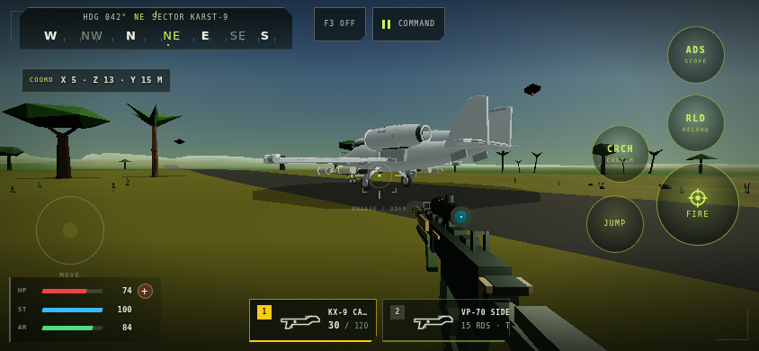
- 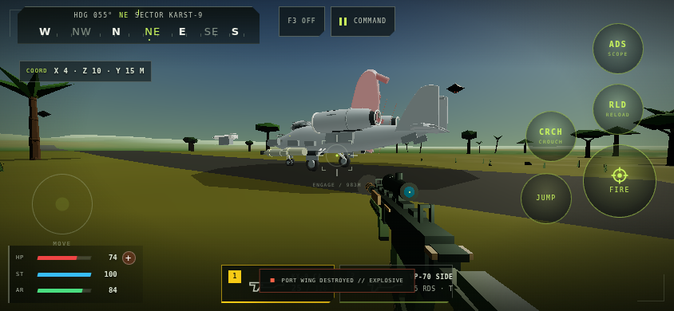
- 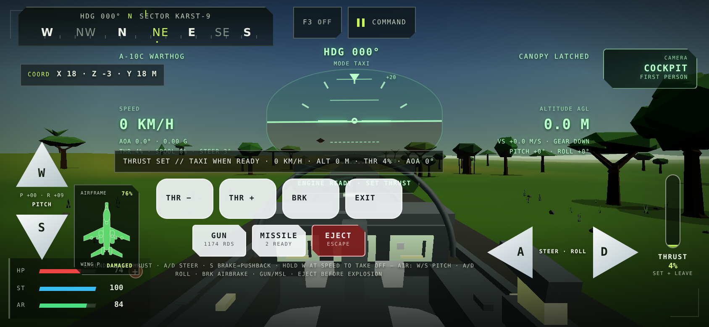
- 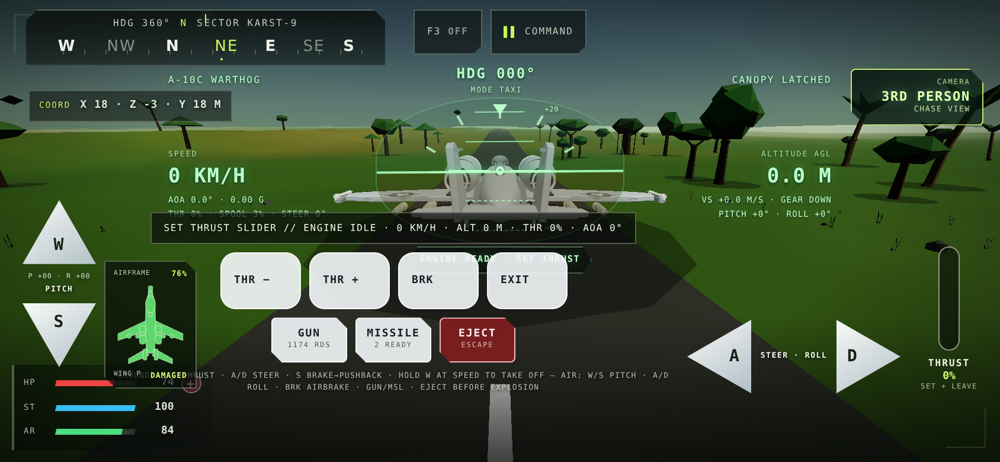
- 
- 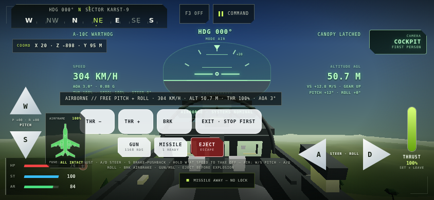
- 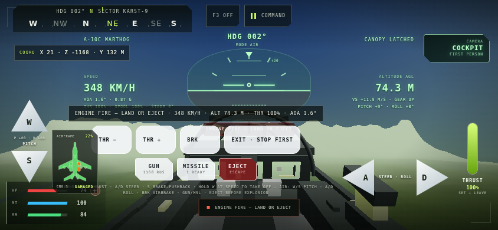
- 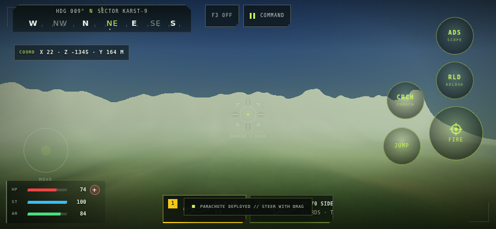
- 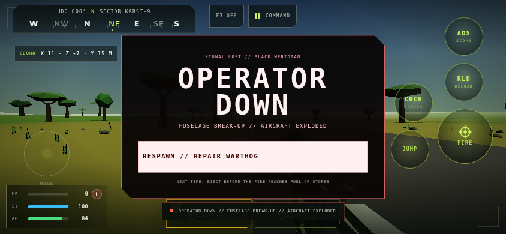
