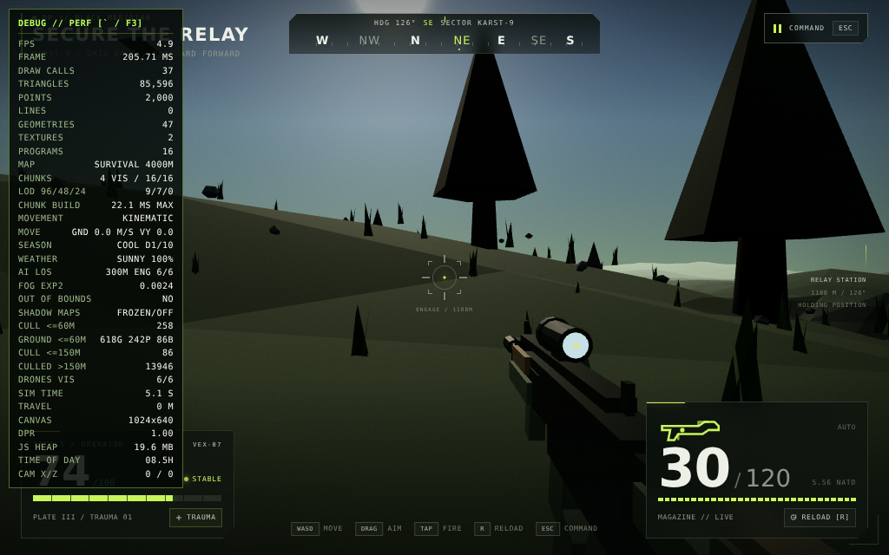
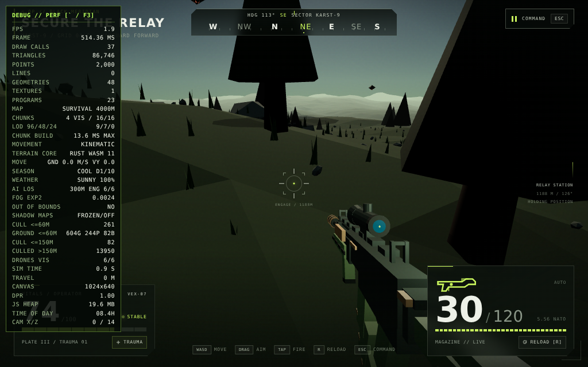
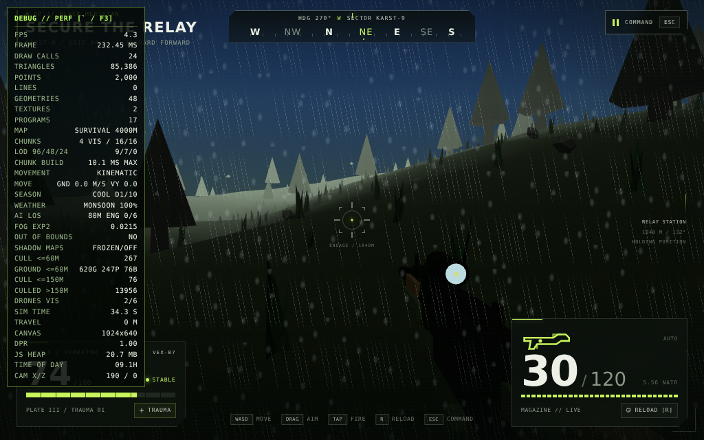
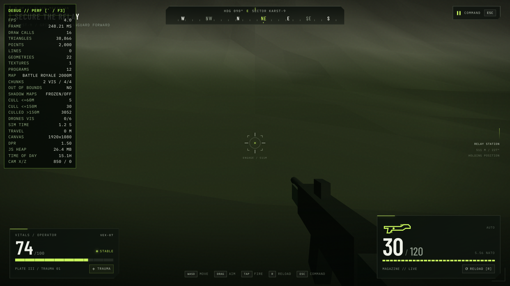
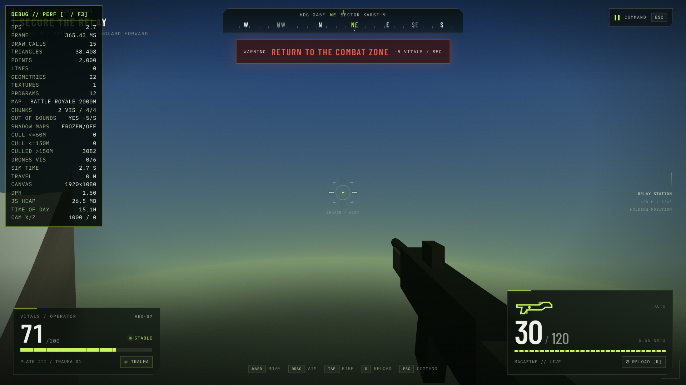
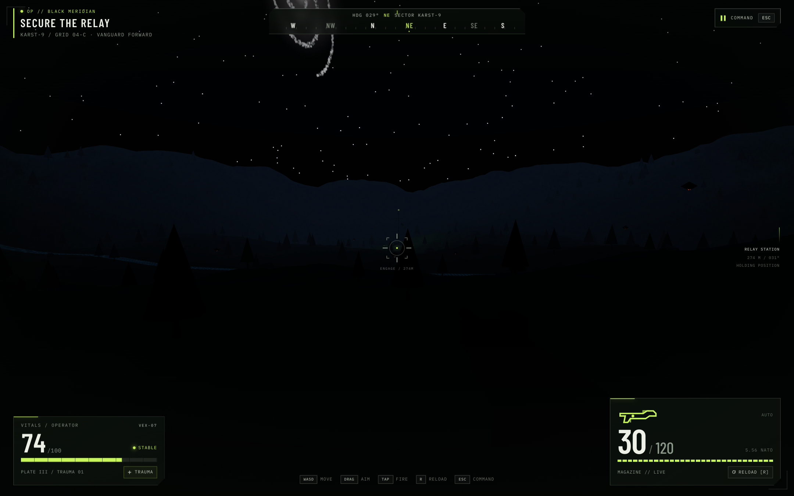
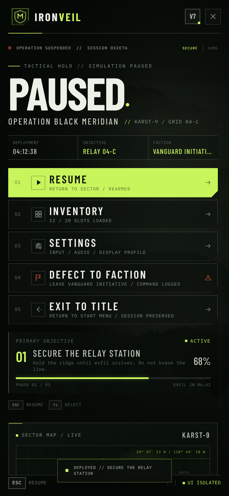

# Social--clone
This is a SoCal clone that is same as Reddit and Instagram but more lightweight and budget.

## IRONVEIL — Tactical Operations (game)

A tactical FPS (React 18 + Zustand + Three.js, built with **Vite**) lives in
[`game/`](game/) — run `cd game && npm install && npm run dev`, then open
<http://localhost:8000>. The start world is a real-time 3D first-person
terrain (procedurally generated Karst-9 ridges, the relay-station objective,
hostile hover drones) — **WASD + drag-aim** on desktop, floating **MOVE /
AIM thumbsticks + FIRE / JUMP buttons** on touch devices (`SPACE` jumps on desktop). A realistic day/night cycle (one 15-minute macro day: 10-minute daylight,
5-minute night; sun, moon, stars, spiral galaxies — `T` skips +3h, `?phase=0.75`
starts at midnight) plays over a river-carved valley with a plank bridge,
and everything is sonified with WebAudio SFX: a recorded rifle shot
(synth fallback), UI clicks, grass/water footsteps, landing thuds,
river, birdsong, crickets, wind (`M` mutes).

Two map presets are selectable on the start screen (or via `?map=br` /
`?map=survival`): **Battle Royale — 2×2 km** (4 chunks) and **Survival —
4×4 km** (16 chunks). Terrain streams in 1 km chunks around a center spawn
at `(0, heightAt(0,0), 0)`; the relay and river are seeded per session
(`?seed=` reproduces a layout). Combat rendering keeps 60 m ground detail
and 150 m silhouettes under climate-driven exponential fog, with clear
~300 m sightlines in Sunny weather. Procedural rim mountains
ring both maps: Survival hard-clamps at ±1950 m, while pressing the BR
±1000 m line triggers **RETURN TO THE COMBAT ZONE** at −5 vitals/sec.

Terrain LOD + streaming: the chunk you stand in and its neighbours stay at
the full 96×96 segments; ring-2 chunks build at 48 and ring-3+ at 24 (fully
far beyond tactical visibility, so detail near the player never drops).
After the Phase 1/2 grounding pass the Survival spawn measured **37 draw
calls / 85,596 triangles / 18.41 MB JS heap**. Chunk builds
run as time-sliced jobs (~3.5 ms of work per frame, prioritised by distance
and view direction, with predictive prefetch), so crossing into a new chunk
no longer hitches. Shooting raycasts run on a BVH
([three-mesh-bvh](https://github.com/gkjohnson/three-mesh-bvh), MIT).
Movement is kinematic and weighty without a rigid-body physics engine:
velocity accelerates toward input speed in ~0.20 s and decays in ~0.15 s,
with slope/water speed factors, gravity, coyote-timed jumping, ground snap,
stride-based camera bob, landing dip, and a damped-spring rifle viewmodel
(sway + synced bob). Grounding comes from instanced blob shadows under the
player, trees and the relay, deterministic instanced grass tufts and small
pebbles inside 60 m, and a merged low-poly tactical rifle viewmodel.

Weather & seasons are gameplay systems. Ten macro days form a season
(Dry → Cool → Monsoon); terrain/foliage palettes, exponential-fog density
and color, sunlight/ambient/exposure, and AI line-of-sight lerp over 30 s.
Every 10 real minutes a weighted roll chooses Sunny, Mist or Monsoon
(Dry 60/30/10, Cool 50/40/10, Monsoon-season 10/40/50 for Sunny/Mist/Rain).
Sunny uses density 0.0024 and 300 m drone LOS with a shader sun halo; Mist
uses 0.034 and 50 m LOS; Monsoon uses 0.0215, 80 m LOS, a screen-space
rain/visor shader, and mud physics (−30% acceleration, longer decel slide).
`?season=dry|cool|monsoon`, `?weather=sunny|mist|monsoon`, and `?day=N`
set the starting climate; the debug overlay (backtick / F3) shows season,
weather blend, fog density, AI LOS and engaged drones.

**Credits:** the recorded gunshot (`game/public/sfx/gunshot.wav`) is from
the Godot engine's TPS demo (© 2018 Juan Linietsky, Godot contributors),
distributed under CC-BY 3.0 — trimmed/mono-mixed here, with per-shot pitch
jitter and a synthesized sub-thump layered in `game/src/audio.js`.

It boots straight to a **Start / Title screen** and **▶ START is playable
instantly** — the systems check (uplink, field feed, armory, squad link,
weapons) is a ~0.4s cosmetic flourish that never blocks input. INVENTORY,
SETTINGS and a mission BRIEFING (controls) are available before you deploy.
In-game, `ESC` (or the COMMAND button) opens the pause menu, which can also
**EXIT TO TITLE**. Back-navigation from the armory/settings returns to the
title screen before deployment and to the pause menu once in the field.

Terrain generation runs on a small **Rust → WebAssembly core**
(`game/wasm/ironveil-core/`, dependency-free): the seeded integer hash,
value-noise FBM and base/rim heights are ported bit-exactly from the JS
implementation (verified max difference 0 across the test grids), and
chunks request their 9,409 raw heights in one batch call (~1.5× faster
than the JS loop in Node; 5.5 KB `.wasm`). The compiled asset is committed
at `game/public/wasm/ironveil_core.wasm` and loaded locally — **fully
offline at runtime, no CDN** — while the identical JS code remains as the
instant fallback (the debug overlay shows `TERRAIN CORE: RUST WASM` when
active). Rebuild it with the *Build Rust WASM terrain core* GitHub Action
(or `cargo build --release --target wasm32-unknown-unknown` locally).
River carving, movement and rendering stay in JS/Three.js.

**Developing:** edit [`game/src/ironveil.jsx`](game/src/ironveil.jsx) (UI) and
[`game/src/world.js`](game/src/world.js) (3D world) — Vite serves with HMR on
port 8000. `npm run build` produces `game/dist/`.

### Screenshots

Captured from the running game in headless Chromium. The terrain is rendered
live by WebGL (no backdrop photo anymore); only Google Fonts was stubbed
locally during capture because the sandbox can't reach it. Desktop shots:
the Survival center spawn, Monsoon weather at 190 m east (AI LOS 80 m,
0/6 drones engaged), the BR rim wall at +850 m, its out-of-bounds warning
at the +1000 m line, and midnight under the stars and galaxies.

**Start menu (desktop):**

**Survival (4×4 km) — center spawn at (0, 0):**

**Rust ABI v2 — baked terrain AO and refined rifle viewmodel:**

**Monsoon weather — screen-space rain, 80 m AI LOS, no drones engaged:**

**Battle Royale — rim mountains rising from +850 m:**

**Battle Royale — out-of-bounds warning at the +1000 m line:**

**Midnight — stars, a spiral galaxy and moonlit ridges:**

**Start menu (mobile):**

**Pause menu (mobile):**

